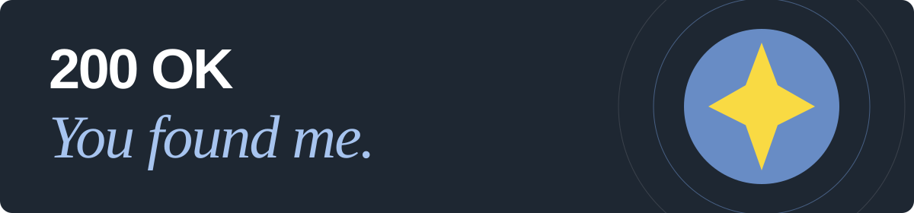

<picture>
  <source media="(prefers-color-scheme: dark)" srcset="assets/banner-dark.svg">
  <source media="(prefers-color-scheme: light)" srcset="assets/banner-light.svg">
  
</picture>

**Hi, I’m Jose.**

I’m a software engineer based in Spain, building software since 2016, with experience in the **retail, sports, and hospitality sectors**.

My work combines product strategy with hands-on engineering, including system design, coding, technical documentation, and guiding teams from concept to production.

Currently building player experiences at Playtomic. Also interested in AI, data, and useful automation.

Open to freelance projects, collaborations, and new opportunities.

[Website](https://jlvadell.com) · [LinkedIn](https://www.linkedin.com/in/jlvadell/)
